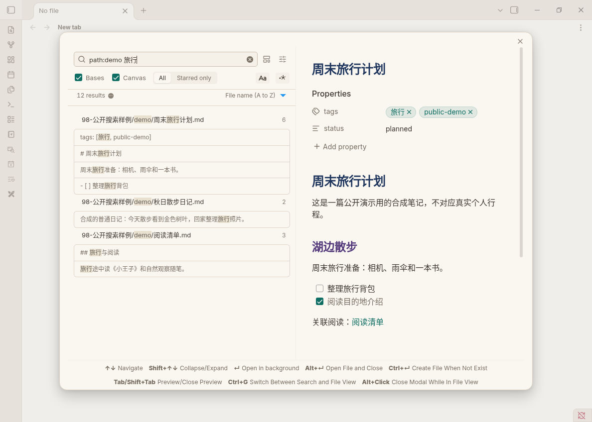
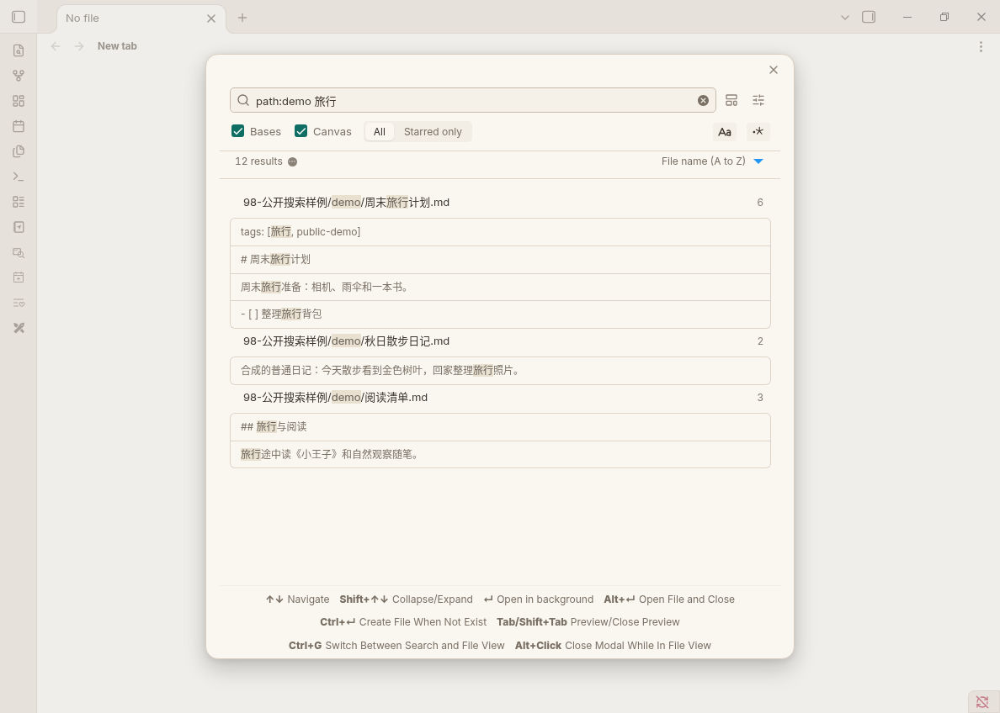
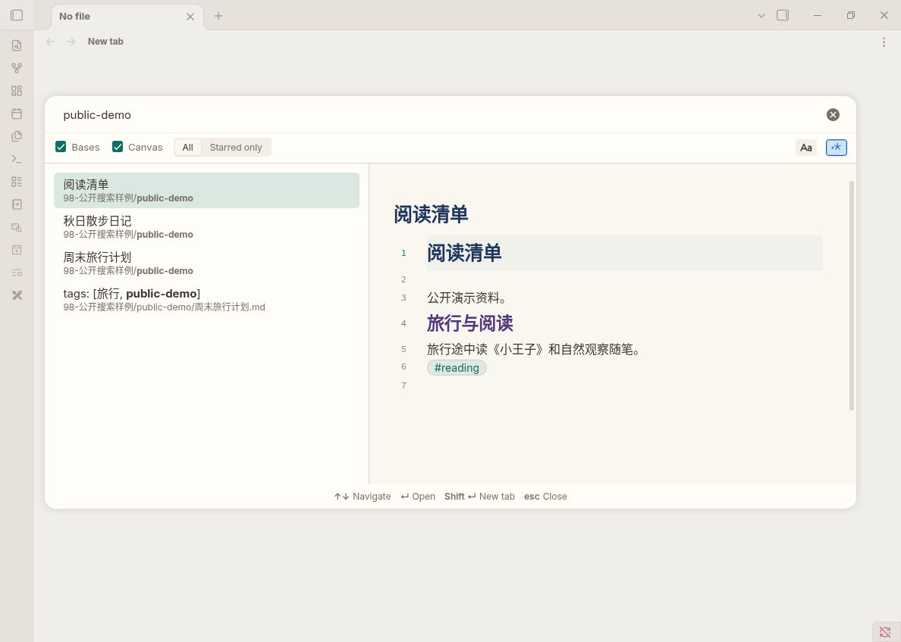

# Float Search Window

在当前笔记上方打开 Obsidian 原生搜索。用 `path:` 或 `tag:` 缩小范围，选中结果就能在一旁预览原文。想按文件名、标题或正文快速跳转时，双击 `Shift` 打开快速搜索；用中文输入法时，快速搜索会等到选词上屏后再更新结果。

[English](./README_en.md) · [安装](#安装) · [命令与快捷键](#命令与快捷键)

**[下载最新发布版](https://github.com/AiurArtanis/Obsidian-Float-Search-Window/releases/latest)。** 1.3.0 适配 Obsidian 1.15.1 的相关性排序，并改进原生文件打开、正则搜索和预览。[1.3.0 版本说明](./RELEASE_NOTES_1.3.0.md)



*Obsidian 1.14.4 · Float Search Window 1.2.0 · 公开演示库中的合成笔记。*

## 安装

本插件使用独立 ID `float-search-window`，目前通过 GitHub Release 或 BRAT 安装。若此前启用了原版 **Floating Search**（`float-search`），请先将其停用，避免两个插件同时响应搜索操作。

**手动安装**

1. 从[最新 Release](https://github.com/AiurArtanis/Obsidian-Float-Search-Window/releases/latest) 的 **Assets** 下载 `main.js`、`manifest.json`、`styles.css`。
2. 将三个文件放入库内的 `.obsidian/plugins/float-search-window/`。如果自定义过配置目录，请将 `.obsidian` 换成该目录名。
3. 重新加载 Obsidian，在 **设置 → 第三方插件** 中启用 **Float Search Window**。

**通过 BRAT 安装**　安装并启用 [BRAT](https://github.com/TfTHacker/obsidian42-brat)，在其设置中添加仓库 `AiurArtanis/Obsidian-Float-Search-Window`，选择已发布的版本，然后启用 **Float Search Window**。

## 搜索与筛选

| 入口 | 怎么用 |
| --- | --- |
| 原生浮动搜索 | 在命令面板运行 **Float Search Window: 全局搜索**。可用 Obsidian 的查询语法，例如 `path:demo 旅行`。按方向键选择命中，按 `Tab` 预览原文。也可在编辑器中选中文字，右键发起搜索。 |
| 快速搜索（CMDK） | 双击 `Shift`，输入文件名、标题或正文片段。用 `↑`、`↓` 选择结果，`Enter` 打开；选择标题或正文命中会跳到对应位置。按 `Esc` 关闭。 |

两个入口的筛选栏都可以勾选是否包含数据库（Bases）和白板（Canvas），在**全部**与**只看收藏**的文件间切换，并用 **Aa** 区分大小写、用 `.*` 切换正则。启用 Obsidian 的书签核心插件后，可以按已加书签的文件筛选。

<details>
<summary>查看原生搜索与快速搜索的筛选栏</summary>

**原生搜索** · 按路径限定搜索后，左侧显示正文匹配。



**快速搜索** · 选择《阅读清单》后，右侧显示对应笔记。



</details>

## 命令与快捷键

在命令面板或 **设置 → 快捷键** 中搜索 `Float Search`。命令默认不绑定热键，快速搜索的双击触发键可单独设置。

| 命令 | 用途 |
| --- | --- |
| 全局搜索 | 从空查询开始。 |
| 全局搜索（保留上次关键字） | 恢复最近的搜索词，约 30 秒后清空。 |
| 在当前文件中搜索 / 搜索当前文件的反向链接 | 将搜索范围限定到当前文件，或查找指向它的链接。 |
| 打开搜索视图（分栏 / 标签页 / 窗口） | 在指定位置打开原生搜索。 |
| 显示/隐藏文件路径 | 切换结果列表中的路径。 |
| 搜索运算符命令 | 插入文件名、路径、标签、行、块、段落、任务或属性等查询条件。 |

<details>
<summary>查看原生浮窗的 Windows 键位与鼠标操作</summary>

| 搜索框内的操作 | 效果 |
| --- | --- |
| `↑` / `↓` | 选择上一条 / 下一条结果。 |
| `Shift+↑` / `Shift+↓` | 折叠 / 展开匹配项。 |
| `Enter` / `Ctrl+Enter` | 后台打开 / 在新的后台标签页打开。 |
| `Alt+Enter` / `Ctrl+Shift+Alt+Enter` | 打开并关闭浮窗 / 在新窗口打开并关闭浮窗。 |
| `Tab` / `Shift+Tab` | 打开 / 关闭右侧预览。 |
| `Ctrl+Shift+C` | 复制选中结果的文字。 |
| `Ctrl+E` / `Ctrl+G` | 切换预览的阅读模式 / 在搜索框与预览之间切换焦点。 |

预览打开时，点击结果会切换预览，按住 `Alt` 点击会打开文件并关闭浮窗。预览关闭时，点击结果会打开文件并关闭浮窗。

</details>

## 设置与 URI

设置页跟随 Obsidian 的界面语言，支持中文和英文。

- **常规**　选择默认打开位置（弹窗、侧边栏、分栏、标签页或窗口），并设置是否显示文件路径和按键提示。
- **快速搜索**　将双击触发键设为 `Shift`、`Ctrl`、`Alt`、`Meta` 或关闭。两次按键的默认最大间隔为 300 毫秒。
- **快速新建**　开启后，若快速搜索没有精确匹配，可以用查询文字作为正文新建笔记。目录和时间戳文件名格式均可设置。

用 URI 从其他应用发起搜索。例如，第一条打开浮窗，第二条打开标签页。

```text
obsidian://fs?query=hello
obsidian://fs?query=world&viewType=tab
```

`viewType` 支持 `modal`（默认）、`sidebar`、`split`、`tab`、`window`。包含空格或其他特殊字符时，请对 `query` 的值进行 URL 编码。

## 原作者与许可

Float Search Window 是 **Boninall（Quorafind）** 创作的 **Floating Search** 的独立续作，由 AiurArtanis 自上游 4.3.0 起维护。原作者已书面同意将本 fork（`float-search-window`）提交到社区目录，并要求保留原作者署名。[上游仓库](https://github.com/Quorafind/Obsidian-Float-Search) · [原作者许可](https://github.com/Quorafind/Obsidian-Float-Search/issues/87#issuecomment-7038819917)

嵌入式预览的工作区视图实现借鉴了 [Hover Editor](https://github.com/nothingislost/obsidian-hover-editor)。本仓库以 [GPL-3.0](./LICENSE) 发布，版权与上游关系见 [NOTICE](./NOTICE)。
