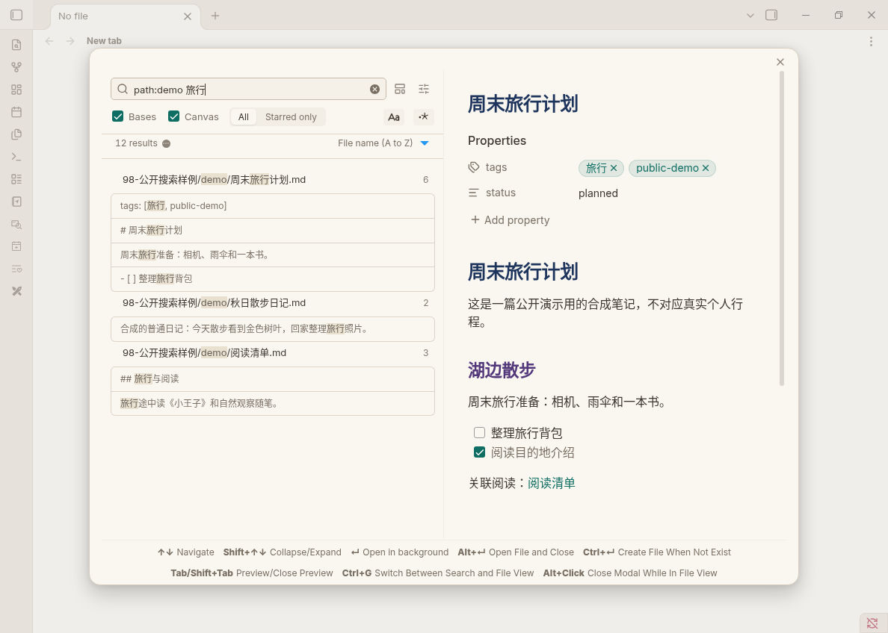
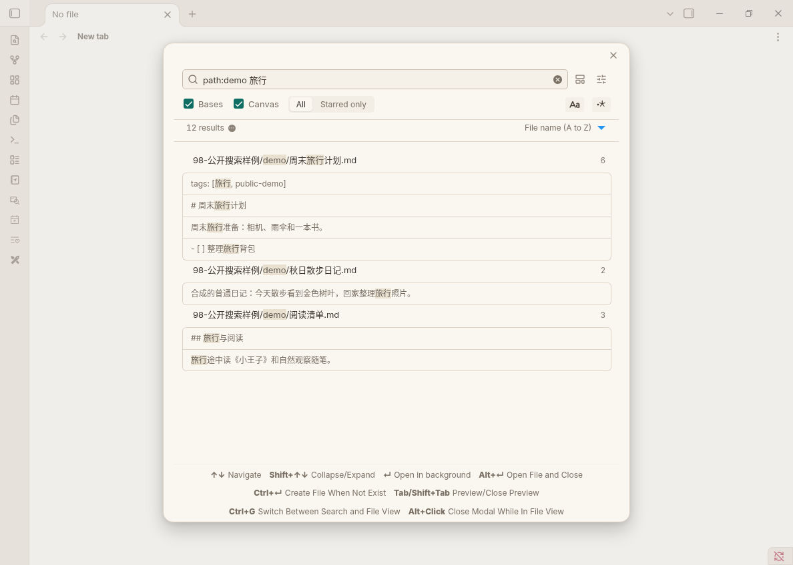
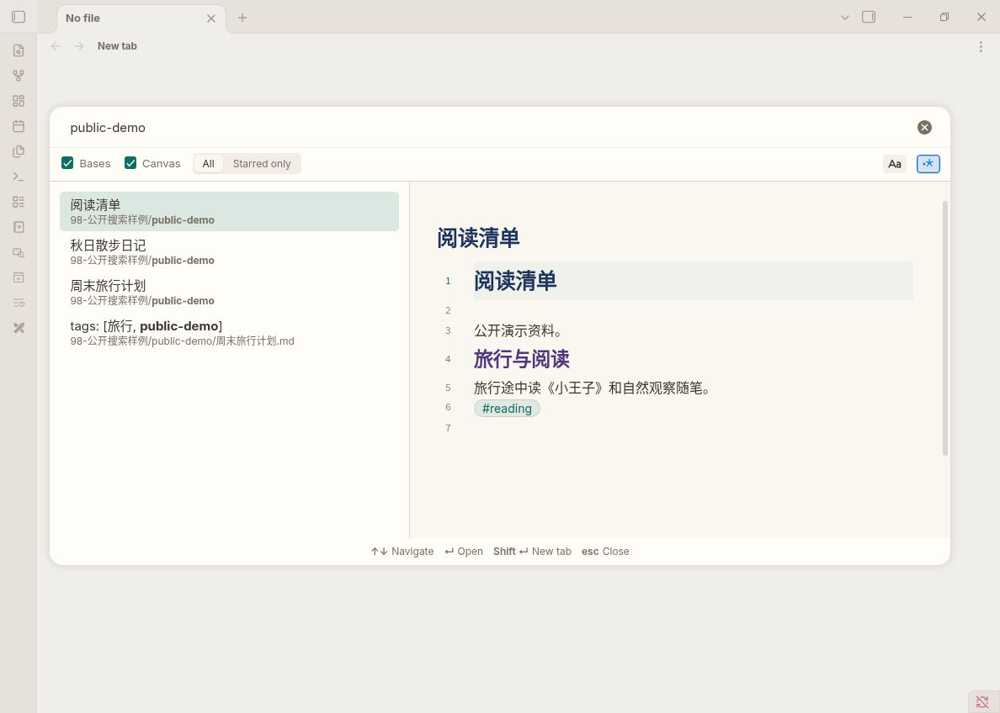

# Float Search Window

Open Obsidian’s native search over the note you’re reading. Narrow a query with `path:` or `tag:`, then preview a match beside the results. To jump straight to a file, heading, or passage, double-tap `Shift` for Quick Search. When you type with a Chinese input method, Quick Search waits for you to confirm the characters before updating results.

[中文](./README.md) · [Install](#install) · [Commands and shortcuts](#commands-and-shortcuts)

**[Download the latest release](https://github.com/AiurArtanis/Obsidian-Float-Search-Window/releases/latest).** Version 1.3.0 supports relevance sorting in Obsidian 1.15.1 and improves native file opening, regex search, and previews. [1.3.0 release notes (Chinese)](./RELEASE_NOTES_1.3.0.md)



*Obsidian 1.14.4 · Float Search Window 1.2.0 · Fictional notes in a public demo vault.*

## Install

The plugin uses its own ID, `float-search-window`, and is currently available through GitHub Releases or BRAT. If the original **Floating Search** (`float-search`) is enabled, disable it first to avoid both plugins handling search actions.

**Manual installation**

1. Download `main.js`, `manifest.json`, and `styles.css` from **Assets** on the [latest release](https://github.com/AiurArtanis/Obsidian-Float-Search-Window/releases/latest).
2. Put all three files in `.obsidian/plugins/float-search-window/` inside your vault. If you use a custom configuration folder, substitute its name for `.obsidian`.
3. Reload Obsidian and enable **Float Search Window** under **Settings → Community plugins**.

**Install with BRAT.** Install and enable [BRAT](https://github.com/TfTHacker/obsidian42-brat). In its settings, add `AiurArtanis/Obsidian-Float-Search-Window`, select a released version, then enable **Float Search Window**.

## Search and filter

| Entry point | How to use it |
| --- | --- |
| Native floating search | Run **Float Search Window: Search obsidian globally** from the command palette. Use Obsidian’s query syntax, for example `path:demo travel`. Select a match with the arrow keys and press `Tab` to preview. You can also select text in the editor and search from its context menu. |
| Quick Search (CMDK) | Double-tap `Shift` and enter a file name, heading, or passage. Choose a result with `↑` or `↓` and press `Enter` to open it. Heading and text matches take you to their location in the note. Press `Esc` to close. |

Both filter bars let you include or exclude Bases and Canvas files. Choose **All** or **Starred only**, use **Aa** to match case, or toggle `.*` for regular expressions. Enable Obsidian’s Bookmarks core plugin to filter by bookmarked files.

<details>
<summary>See the filter bar in each search view</summary>

**Native search** · A path-restricted query shows matching passages under each note.



**Quick Search** · Selecting the sample reading list shows the note beside the results.



</details>

## Commands and shortcuts

Search for `Float Search` in the command palette or under **Settings → Hotkeys**. Commands have no default hotkeys. The double-tap trigger for Quick Search is configured separately.

| Command | What it does |
| --- | --- |
| Search obsidian globally | Start with an empty query. |
| Search Obsidian Globally (With Last State) | Restore the previous query, which expires after about 30 seconds. |
| Search in current file / Search in backlink Of current file | Search within the active file or find links pointing to it. |
| Open search view (split / tab / window) | Open native search in the chosen location. |
| Show/hide file path | Toggle paths in the results list. |
| Search operator commands | Insert a query for a file name, path, tag, line, block, section, task, or property. |

<details>
<summary>Windows keyboard and mouse controls for native floating search</summary>

| With the search input focused | Action |
| --- | --- |
| `↑` / `↓` | Select the previous / next result. |
| `Shift+↑` / `Shift+↓` | Collapse / expand matches. |
| `Enter` / `Ctrl+Enter` | Open in the background / in a new background tab. |
| `Alt+Enter` / `Ctrl+Shift+Alt+Enter` | Open and close the search window / open in a new window and close search. |
| `Tab` / `Shift+Tab` | Open / close the preview on the right. |
| `Ctrl+Shift+C` | Copy the selected result text. |
| `Ctrl+E` / `Ctrl+G` | Toggle reading view / move focus between the search input and preview. |

With a preview open, clicking another result updates the preview. `Alt+click` opens the file and closes the search window. With the preview closed, clicking a result opens the file and closes search.

</details>

## Settings and URI

Settings follow Obsidian’s interface language and are available in Chinese and English.

- **General** controls where search opens (modal, sidebar, split, tab, or window), file paths, and key hints.
- **Quick Search** lets you choose a double-tap trigger (`Shift`, `Ctrl`, `Alt`, or `Meta`) or disable it. The default interval is 300 ms.
- **Quick Create** lets you create a note from the query text when Quick Search finds no exact match. Choose a destination folder and a timestamp format for the file name.

Use a URI to start a search from another app. The first example opens a modal and the second opens a tab.

```text
obsidian://fs?query=hello
obsidian://fs?query=world&viewType=tab
```

Supported `viewType` values are `modal` (default), `sidebar`, `split`, `tab`, and `window`. URL-encode the query value if it contains spaces or other special characters.

## Credits and license

Float Search Window is an independent continuation of **Floating Search**, originally written by **Boninall (Quorafind)** and maintained in this fork by AiurArtanis since upstream 4.3.0. The original author granted written permission to list this fork (`float-search-window`) in the community directory with original-author credit. [Upstream project](https://github.com/Quorafind/Obsidian-Float-Search) · [Permission from the original author](https://github.com/Quorafind/Obsidian-Float-Search/issues/87#issuecomment-7038819917)

The embedded workspace view draws on [Hover Editor](https://github.com/nothingislost/obsidian-hover-editor). This repository is licensed under [GPL-3.0](./LICENSE). See [NOTICE](./NOTICE) for copyright and upstream attribution.
